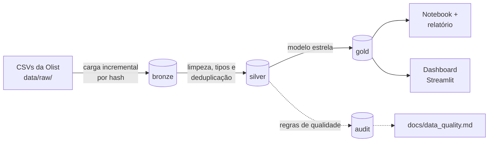
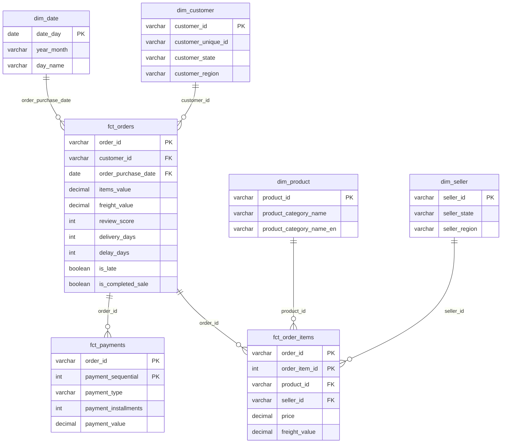

# Olist E-commerce Pipeline

Pipeline ETL que transforma os dados públicos do marketplace brasileiro **Olist** em informação
confiável para o negócio: os CSVs brutos passam pelas camadas **bronze → silver → gold** de um
mini Data Warehouse em **DuckDB** e alimentam análises em notebook, um relatório em Markdown e um
dashboard em Streamlit.

> 🚧 Em construção: as seções marcadas como _(em construção)_ serão concluídas nas próximas etapas.

## Sumário

1. [Visão geral e arquitetura](#1-visão-geral-e-arquitetura)
2. [Como executar do zero](#2-como-executar-do-zero)
3. [Estrutura do repositório](#3-estrutura-do-repositório)
4. [Decisões de modelagem](#4-decisões-de-modelagem)
5. [Regras de qualidade](#5-regras-de-qualidade)
6. [Premissas](#6-premissas)
7. [Limitações dos dados](#7-limitações-dos-dados)
8. [Análises](#8-análises)
9. [Uso de IA](#9-uso-de-ia)

## 1. Visão geral e arquitetura



| Camada | O que guarda | Como é atualizada |
|---|---|---|
| **raw** (`data/raw/`) | Os CSVs originais, nunca alterados | Arquivos novos são acrescentados à pasta |
| **bronze** | Cópia fiel dos CSVs (tudo como texto) + colunas de controle | Só recebe inserções, controladas por hash |
| **silver** | Uma tabela limpa por entidade, com tipos corretos e flags de qualidade | Recalculada a partir da bronze a cada execução |
| **gold** | Modelo estrela pronto para análise, com as métricas de entrega | Recalculada a partir da silver e conferida por 21 checagens |
| **audit** | Log de cargas e resultado das regras de qualidade | A cada execução |

Tudo roda localmente, sem servidor: o Data Warehouse é um único arquivo (`warehouse/olist.duckdb`).

## 2. Como executar do zero

**Pré-requisitos:** Python 3.11 ou superior (desenvolvido em 3.12) e Git.

1. **Clone o repositório e crie o ambiente virtual**

   ```powershell
   # Windows (PowerShell)
   git clone https://github.com/arthurgomesf/olist-ecommerce-pipeline.git
   cd olist-ecommerce-pipeline
   py -3.12 -m venv .venv
   .venv\Scripts\python -m pip install -r requirements.txt
   ```

   ```bash
   # Linux / macOS
   git clone https://github.com/arthurgomesf/olist-ecommerce-pipeline.git
   cd olist-ecommerce-pipeline
   python3 -m venv .venv
   .venv/bin/python -m pip install -r requirements.txt
   ```

2. **Baixe os dados** do [Brazilian E-Commerce Public Dataset by Olist](https://www.kaggle.com/datasets/olistbr/brazilian-ecommerce)
   (botão _Download_; o Kaggle pode pedir login) e extraia os **9 arquivos `.csv`** em `data/raw/`.
   Os dados não ficam no repositório (licença CC BY-NC-SA 4.0 e ~126 MB).

3. **Rode o pipeline** (no Linux/macOS, troque `.venv\Scripts\python` por `.venv/bin/python`):

   ```powershell
   .venv\Scripts\python -m src.pipeline
   ```

   O pipeline cria `warehouse/olist.duckdb`, mostra no log quantas linhas entraram em cada etapa,
   roda as checagens de integridade da gold (se alguma falhar, ele para com erro) e regenera
   `docs/data_quality.md`. Rodar de novo **não duplica nada** (ver seção 4).

4. **Rode os testes**

   ```powershell
   .venv\Scripts\python -m pytest
   ```

> Se o arquivo `warehouse/olist.duckdb` estiver aberto em outro programa (notebook, dashboard),
> o pipeline avisa e para: o DuckDB permite um único processo escrevendo no arquivo.

## 3. Estrutura do repositório

```
├── data/raw/              # CSVs originais (não versionados)
├── warehouse/             # olist.duckdb, gerado pelo pipeline (não versionado)
├── src/
│   ├── config.py          # caminhos e lista de fontes e tabelas
│   ├── bronze.py          # carga incremental CSV -> bronze
│   ├── transform.py       # executa os SQL de cada camada
│   ├── quality.py         # calcula e registra as regras de qualidade
│   ├── checks.py          # checagens de integridade da gold (param o pipeline se falharem)
│   ├── docs.py            # gera docs/data_quality.md
│   ├── pipeline.py        # orquestra tudo: python -m src.pipeline
│   ├── analysis.py        # roda as consultas das análises (usado no notebook e no dashboard)
│   └── charts.py          # gráficos das análises, com um padrão visual único
├── sql/
│   ├── silver/            # uma transformação por tabela (+ _functions.sql)
│   ├── quality/           # as regras de qualidade de cada tabela da silver
│   ├── gold/              # dimensões e fatos do modelo estrela (+ _functions.sql)
│   ├── checks/            # as checagens de integridade da gold
│   └── analysis/          # uma consulta por pergunta de negócio
├── notebooks/
│   └── analysis.ipynb     # as cinco análises: gráficos e conclusões
├── docs/
│   ├── data_quality.md    # gerado pelo pipeline a cada execução
│   ├── analysis_report.md # gerado pelo notebook: perguntas, gráficos e conclusões
│   └── figures/           # os gráficos em PNG
├── tests/                 # testes automatizados (pytest)
└── requirements.txt
```

## 4. Decisões de modelagem

**Por que DuckDB:** é um banco analítico (colunar) que roda dentro do Python, sem servidor: o
avaliador reproduz tudo com `pip install`. Lê CSV nativamente e tem SQL completo.

**Por que camadas:** a raw nunca é alterada, então qualquer resultado pode ser reconstruído e
auditado desde a origem; cada camada tem uma única responsabilidade.

### Bronze: carga incremental e fiel

- Cada CSV entra **como texto puro**: nenhuma conversão implícita (o CEP `01037` continua `01037`,
  com o zero à esquerda). Converter tipos é decisão explícita da silver.
- Cada linha recebe colunas de controle: `_row_hash` (md5 do conteúdo da linha), `_batch_id`,
  `_source_file` e `_ingested_at`.
- **Só entram linhas cujo hash ainda não existe.** Rodar o pipeline de novo não duplica nada, e um
  arquivo novo na raw (ex.: `olist_orders_dataset_2018-11.csv`) acrescenta só o que é novo ou mudou.
- Cada arquivo entra numa transação (tudo ou nada), e um arquivo com colunas diferentes das
  esperadas é recusado com erro, em vez de gravar dado errado.
- `audit.load_log` registra, por lote, as linhas lidas e inseridas de cada arquivo.

### Silver: uma tabela limpa por entidade

- **Versão mais recente** de cada registro pela chave de negócio (maior lote; dentro do mesmo lote,
  o arquivo que vem depois na ordem do nome). Em volume grande, a recalculação daria lugar a um
  `MERGE` só com os lotes novos.
- **Tipos explícitos** com `try_cast` (valor inválido vira nulo e é contado). Valores monetários em
  `DECIMAL(12,2)`: com ponto flutuante, 76 pedidos com diferença de exatamente R$ 0,01 entre o total
  pago e o total dos itens apareciam como divergentes por erro de arredondamento.
- **Sinalizar em vez de apagar:** problemas viram flags `dq_*`; só saem da silver duplicatas e
  registros sem informação. Nada se perde, porque a bronze guarda tudo.
- **Escolhas de grão:**
  - `order_reviews`: **uma avaliação por pedido** (a respondida por último), para nenhum pedido
    contar duas vezes na satisfação.
  - `customers`: o `customer_id` é gerado a cada pedido; **a pessoa é o `customer_unique_id`**
    (2.997 pessoas têm mais de um `customer_id`).
  - `geolocation`: **uma linha por prefixo de CEP**, com a mediana das coordenadas e a cidade mais
    frequente.
- **"O CEP manda" na localização do vendedor:** cidade e UF são digitadas pelo vendedor, o CEP é
  validado. Quando divergem, vale o CEP. O cadastro de vendedores parece vir com "SP" preenchido
  por padrão (quase todas as UFs corrigidas eram "SP"). Já a UF dos clientes não diverge do CEP em
  nenhum caso verificável (regra CUS-04), por isso as análises por estado do cliente são confiáveis.
- A mesma função `normalize_city()` padroniza cidades em clientes, vendedores e geolocalização,
  para que a comparação entre tabelas seja justa.

### Gold: modelo estrela



| Tabela | Grão (1 linha por…) | Para que serve |
|---|---|---|
| `fct_orders` | pedido | **Tabela derivada com as métricas de entrega**, valores do pedido e nota da avaliação |
| `fct_order_items` | item de pedido | Receita por produto, categoria e vendedor |
| `fct_payments` | pagamento | Meios de pagamento e parcelas |
| `dim_customer` | `customer_id` (cliente do pedido) | UF, região, cidade, coordenadas e `customer_unique_id` |
| `dim_product` | produto | Categoria em português e em inglês, peso e medidas |
| `dim_seller` | vendedor | UF, região, cidade e coordenadas |
| `dim_date` | dia | Ano, mês, ano-mês e dia da semana |

**Por que estrela:** as perguntas de negócio são do tipo "medida por dimensão" (receita por
categoria, prazo por estado). Na estrela, cada pergunta sai com um ou dois joins simples, e cada
tabela tem um grão explícito.

**Por que dois fatos principais (pedido e item):** são dois grãos de negócio diferentes. Se o
frete, o pagamento e a nota ficassem em cada item, um pedido com três itens teria a nota contada
três vezes (_fan-out_). Por isso os valores do pedido são agregados no grão do pedido.

**Por que `dim_customer` no grão `customer_id`:** o `customer_id` carrega o endereço de entrega
daquele pedido, que é o que importa para logística por estado; a pessoa (`customer_unique_id`)
fica como atributo, para medir recompra.

Métricas de entrega do `fct_orders` (preenchidas só para pedidos entregues com data de entrega):

| Métrica | Definição |
|---|---|
| `delivery_days` | Dias corridos entre a compra e a entrega ao cliente |
| `estimated_days` | Dias corridos entre a compra e a data prometida |
| `delay_days` | Entrega − data prometida, em dias (positivo = atraso; negativo = antes do prazo) |
| `is_late` | Entregue depois do **dia** prometido |

A premissa de receita fica definida em um único lugar, a função `is_completed_sale()` em
`sql/gold/_functions.sql`, e não espalhada pelas consultas.

## 5. Regras de qualidade

Cada tabela da silver tem um arquivo em `sql/quality/` com as suas regras: o que foi feito, a ação
(remover, corrigir, sinalizar ou manter), o motivo e quantas linhas foram afetadas. O pipeline grava
o resultado em `audit.quality_log` e gera a lista completa, com as contagens, em
[`docs/data_quality.md`](docs/data_quality.md). Os números nunca são digitados à mão.

Os casos que mais mudam o dado:

- **Geolocalização:** 26% das linhas eram duplicatas exatas; pontos com coordenadas fora do Brasil
  (erros de geocodificação) são descartados, preservando Fernando de Noronha.
- **Avaliações:** pedidos com mais de uma avaliação ficam com a mais recente.
- **Produtos:** categoria traduzida para inglês, com tradução manual para as duas categorias que
  faltam no arquivo oficial; produtos sem categoria recebem o rótulo `unknown`, para que a receita
  deles não suma das análises por categoria.
- **Vendedores:** cidade padronizada e localização corrigida pelo CEP.
- **Pagamentos:** pagamentos sem tipo e sem valor são removidos; parcelas zeradas viram 1.

Depois da gold, **21 checagens de integridade** conferem chaves únicas, se todo fato aponta para uma
dimensão existente, valores dentro do domínio (nota de 1 a 5, prazo nunca negativo) e se os totais
da gold batem com os da silver. Se alguma encontrar violações, o pipeline para com erro antes de
gerar a documentação. O resultado também fica em [`docs/data_quality.md`](docs/data_quality.md).

## 6. Premissas

- **Receita** = soma do preço dos itens (`price`, sem frete) dos **pedidos entregues**. Pedidos
  cancelados, indisponíveis e os que seguem "em andamento" ficam de fora (ver limitações).
  Considerar os pedidos em andamento aumentaria a receita em cerca de 2%.
- **A receita vem dos itens, não dos pagamentos:** o total pago inclui juros de parcelamento e
  vouchers e difere de itens + frete em parte dos pedidos.
- **Atraso** é comparado por **data**: a data prometida não tem hora (00:00), então comparar com o
  horário da entrega marcaria como atrasada uma entrega feita no próprio dia prometido.
- **Tempo de entrega** em dias corridos, da compra à entrega ao cliente.
- **Cliente** é o `customer_unique_id`, não o `customer_id`.
- **Uma avaliação por pedido:** a respondida por último.
- **Localização do vendedor:** o CEP prevalece sobre a cidade e a UF digitadas.

_Definições específicas de cada análise ficam junto da análise, na seção 8 (em construção)._

## 7. Limitações dos dados

- **Sem custo dos produtos nem comissão:** não há como calcular margem ou lucro; "receita" aqui é o
  valor de venda dos produtos no marketplace.
- **Dados anonimizados e só com o prefixo do CEP** (5 dígitos): a localização é aproximada, e parte
  dos CEPs de clientes e vendedores não existe na base de geolocalização.
- **Prefixos de CEP que cobrem mais de uma cidade:** a "cidade do CEP" é a mais frequente no prefixo.
  Por isso um vendedor de Monte Alegre do Sul (SP) passou a constar como Jaguariúna, a cidade vizinha.
- **Pedidos travados:** parte dos pedidos segue "enviado", "faturado" ou "em separação" há mais de
  seis meses no fim dos dados (regra ORD-08): provavelmente nunca foram concluídos. O dataset não
  tem histórico de status para confirmar; por isso eles ficam fora da receita.
- **Janela de 09/2016 a 10/2018**, com meses das pontas quase vazios.

_(lista em construção)_

## 8. Análises

Uma pergunta por tópico, respondida a partir da gold, com gráfico e conclusão de negócio:

| Tópico | Pergunta |
|---|---|
| Vendas | Como a receita total varia mês a mês? |
| Logística | Qual o tempo médio de entrega, em dias, por estado? |
| Satisfação | Pedidos atrasados têm nota média menor que os entregues no prazo? |
| Financeiro | Qual o valor médio do frete por estado do cliente? |
| Clientes | Qual a porcentagem de clientes que compraram mais de uma vez? |

- **Leitura rápida:** [`docs/analysis_report.md`](docs/analysis_report.md), com os gráficos e as
  conclusões.
- **Código e tabelas:** [`notebooks/analysis.ipynb`](notebooks/analysis.ipynb). Cada pergunta tem a
  sua consulta em `sql/analysis/`.

Para regenerar os gráficos e o relatório (depois do pipeline):

```powershell
.venv\Scripts\python -m jupyter nbconvert --to notebook --execute --inplace notebooks/analysis.ipynb
```

_(resumo dos resultados em construção)_

## 9. Uso de IA

_(a ser escrito pelo autor)_
