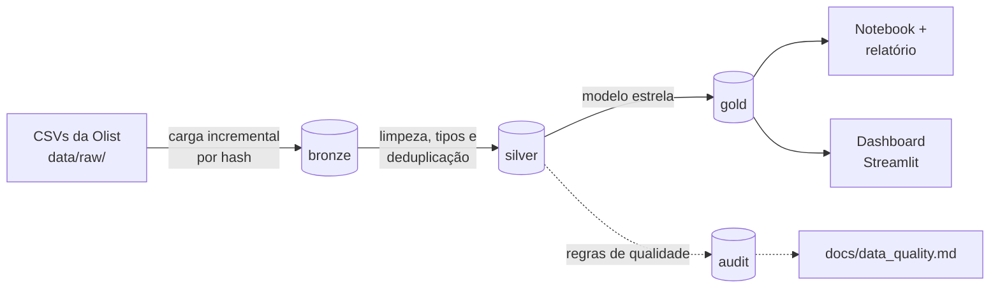
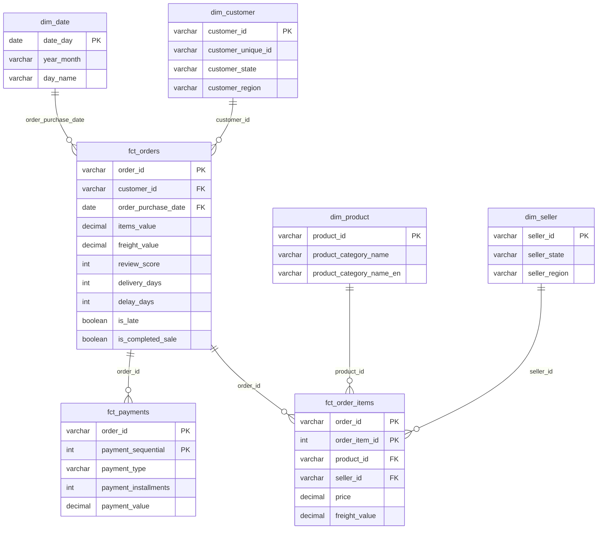
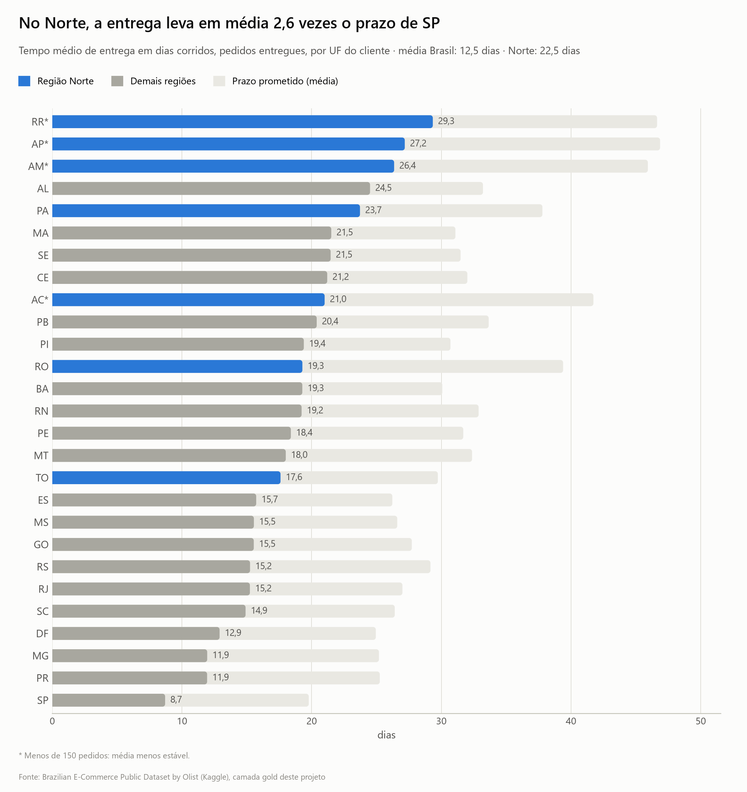

# Olist E-commerce Pipeline

Pipeline ETL que transforma os dados públicos do marketplace brasileiro **Olist** em informação
confiável para o negócio: os CSVs brutos passam pelas camadas **bronze → silver → gold** de um
mini Data Warehouse em **DuckDB** e alimentam análises em notebook, um relatório em Markdown e um
dashboard em Streamlit.

**Destaques**

- **Carga incremental por hash:** rodar o pipeline de novo não duplica nada, e um arquivo novo
  acrescenta só as linhas novas ou alteradas.
- **43 regras de qualidade documentadas**, com o que foi removido, corrigido ou sinalizado, o motivo
  e quantas linhas cada uma afetou, em um relatório gerado a cada execução (nenhum número digitado
  à mão).
- **21 checagens de integridade** na gold: se algo quebrar, a gold nova é descartada, a anterior
  continua valendo e o pipeline para com erro.
- **Pronto para rodar:** os dados já vêm no repositório; clonado do zero e executado com os
  comandos da seção 2, o projeto gera relatórios e gráficos idênticos aos versionados.
- **Cinco análises**, cada uma com gráfico e conclusão de negócio, em notebook, relatório em
  Markdown e dashboard interativo.

## Sumário

1. [Visão geral e arquitetura](#1-visão-geral-e-arquitetura)
2. [Como executar do zero](#2-como-executar-do-zero)
3. [Estrutura do repositório](#3-estrutura-do-repositório)
4. [Decisões de modelagem](#4-decisões-de-modelagem)
5. [Regras de qualidade](#5-regras-de-qualidade)
6. [Premissas](#6-premissas)
7. [Limitações dos dados](#7-limitações-dos-dados)
8. [Análises](#8-análises)
9. [Uso de IA](#9-uso-de-ia)
10. [Próximos passos](#10-próximos-passos)

## 1. Visão geral e arquitetura



| Camada | O que guarda | Como é atualizada |
|---|---|---|
| **raw** (`data/raw/`) | Os CSVs originais, nunca alterados | Arquivos novos são acrescentados à pasta |
| **bronze** | Cópia fiel dos CSVs (tudo como texto) + colunas de controle | Só recebe inserções, controladas por hash |
| **silver** | Uma tabela limpa por entidade, com tipos corretos e flags de qualidade | Recalculada a partir da bronze a cada execução |
| **gold** | Modelo estrela pronto para análise, com as métricas de entrega | Recalculada a partir da silver e só publicada se passar nas 21 checagens |
| **audit** | Log de cargas e resultado das regras de qualidade | A cada execução |

Tudo roda localmente, sem servidor: o Data Warehouse é um único arquivo (`warehouse/olist.duckdb`).

## 2. Como executar do zero

**Pré-requisitos:** Python 3.11 ou superior (desenvolvido em 3.12) e Git. Os dados já vêm no
repositório (fonte e licença no fim desta seção).

Todos os comandos, para copiar e colar de uma vez:

```powershell
# Windows (PowerShell)
git clone https://github.com/arthurgomesf/olist-ecommerce-pipeline.git
cd olist-ecommerce-pipeline
py -3.12 -m venv .venv                     # ou outra versão 3.11+, ex.: py -3.11
.venv\Scripts\python -m pip install -r requirements.txt
.venv\Scripts\python -m src.pipeline
.venv\Scripts\python -m pytest
.venv\Scripts\python -m streamlit run app/dashboard.py
```

```bash
# Linux / macOS
git clone https://github.com/arthurgomesf/olist-ecommerce-pipeline.git
cd olist-ecommerce-pipeline
python3 -m venv .venv
.venv/bin/python -m pip install -r requirements.txt
.venv/bin/python -m src.pipeline
.venv/bin/python -m pytest
.venv/bin/python -m streamlit run app/dashboard.py
```

O que cada comando faz:

1. **Ambiente virtual e dependências:** isolam as bibliotecas do projeto, com as versões fixadas
   em `requirements.txt`.
2. **Pipeline (`src.pipeline`):** cria `warehouse/olist.duckdb`, mostra no log quantas linhas
   entraram em cada etapa, roda as checagens de integridade da gold (se alguma falhar, ele descarta
   a gold nova, mantém a anterior e para com erro) e regenera `docs/data_quality.md`. Rodar de novo **não duplica nada** (ver seção 4).
3. **Testes (`pytest`):** conferem a carga incremental, as regras da silver, as métricas da gold,
   as checagens de integridade e o dashboard.
4. **Dashboard (`streamlit`):** abre direto no navegador em `http://localhost:8501`; para
   encerrar, `Ctrl+C`.

> No Windows, se o `pip` falhar com `OSError` e uma dica sobre _Long Path support_, o caminho
> da pasta ficou longo demais para alguns pacotes do Jupyter: clone numa pasta de caminho curto
> (ex.: `C:\projetos`) ou [habilite caminhos longos](https://pip.pypa.io/warnings/enable-long-paths).

> Se o arquivo `warehouse/olist.duckdb` estiver aberto em outro programa (notebook, dashboard),
> o pipeline avisa e para: o DuckDB permite um único processo escrevendo no arquivo.

**Sobre os dados:** os 9 CSVs em `data/raw/` são os originais do
[Brazilian E-Commerce Public Dataset by Olist](https://www.kaggle.com/datasets/olistbr/brazilian-ecommerce),
sem nenhuma alteração, distribuídos sob a licença CC BY-NC-SA 4.0. Eles estão no repositório para o
projeto rodar logo após o clone; em produção, a raw ficaria num armazenamento de objetos (ex.: S3),
e não no Git. O arquivo `.gitattributes` impede o Git de converter as quebras de linha dos CSVs,
para que fiquem idênticos aos originais em qualquer sistema operacional.

## 3. Estrutura do repositório

```
├── data/raw/              # os 9 CSVs originais do Kaggle, sem alterações
├── warehouse/             # olist.duckdb, gerado pelo pipeline (não versionado)
├── src/
│   ├── config.py          # caminhos e lista de fontes e tabelas
│   ├── bronze.py          # carga incremental CSV -> bronze
│   ├── transform.py       # executa os SQL de cada camada
│   ├── quality.py         # calcula e registra as regras de qualidade
│   ├── checks.py          # checagens de integridade da gold (param o pipeline se falharem)
│   ├── docs.py            # gera docs/data_quality.md
│   ├── pipeline.py        # orquestra tudo: python -m src.pipeline
│   ├── analysis.py        # roda as consultas das análises (usado no notebook e no dashboard)
│   └── charts.py          # gráficos das análises, com um padrão visual único
├── sql/
│   ├── silver/            # uma transformação por tabela (+ _functions.sql)
│   ├── quality/           # as regras de qualidade de cada tabela da silver
│   ├── gold/              # dimensões e fatos do modelo estrela (+ _functions.sql)
│   ├── checks/            # as checagens de integridade da gold
│   └── analysis/          # uma consulta por pergunta de negócio
├── notebooks/
│   └── analysis.ipynb     # as cinco análises: gráficos e conclusões
├── app/
│   └── dashboard.py       # dashboard interativo (Streamlit) com as mesmas consultas
├── docs/
│   ├── data_quality.md    # gerado pelo pipeline a cada execução
│   ├── analysis_report.md # gerado pelo notebook: perguntas, gráficos e conclusões
│   └── figures/           # os gráficos em PNG
├── tests/                 # testes automatizados (pytest)
└── requirements.txt
```

## 4. Decisões de modelagem

**DuckDB** como Data Warehouse: banco analítico que roda dentro do Python, sem servidor, lê CSV
nativamente e tem SQL completo. **Camadas** porque a raw nunca é alterada: qualquer resultado pode
ser reconstruído e auditado desde a origem, e cada camada tem uma única responsabilidade.

- **Bronze (incremental e fiel):** cada CSV entra como texto puro, sem conversão implícita (o CEP
  `01037` mantém o zero à esquerda), e cada linha ganha colunas de controle: hash do conteúdo, lote,
  arquivo e horário. Só entram linhas com hash novo, então rodar de novo não duplica nada e um
  arquivo novo acrescenta só o que mudou. Cada arquivo entra numa transação, e um arquivo com
  colunas diferentes das esperadas é recusado.
- **Silver (uma tabela limpa por entidade):** fica a versão mais recente de cada registro. Os tipos
  são convertidos com `try_cast`, e os valores monetários usam `DECIMAL(12,2)`: com ponto
  flutuante, 76 pedidos apareciam com uma divergência falsa de R$ 0,01. Problemas viram flags `dq_*`
  em vez de apagar linhas, e nada se perde, porque a bronze guarda tudo.
- **Gold (modelo estrela):** as perguntas de negócio são do tipo "medida por dimensão" (receita por
  categoria, prazo por estado), então cada uma sai com um ou dois joins simples.



| Tabela | Grão (1 linha por…) | Para que serve |
|---|---|---|
| `fct_orders` | pedido | **Tabela derivada** com as métricas de entrega, os valores do pedido e a nota |
| `fct_order_items` | item de pedido | Receita por produto, categoria e vendedor |
| `fct_payments` | pagamento | Meios de pagamento e parcelas |
| `dim_customer` | `customer_id` | Endereço da entrega (UF e região) e a pessoa (`customer_unique_id`) |
| `dim_product` | produto | Categoria em português e em inglês |
| `dim_seller` | vendedor | UF e região |
| `dim_date` | dia | Ano, mês e dia da semana |

**Dois fatos, pedido e item,** porque são grãos diferentes: se o frete e a nota ficassem em cada
item, um pedido com três itens teria a nota contada três vezes (_fan-out_).

| Métrica do `fct_orders` | Definição (só pedidos entregues com data de entrega) |
|---|---|
| `delivery_days` | Dias corridos da compra à entrega |
| `estimated_days` | Dias corridos da compra à data prometida |
| `delay_days` | Entrega − data prometida (positivo = atraso) |
| `is_late` | Entregue depois do **dia** prometido |

## 5. Regras de qualidade

Cada tabela da silver tem um arquivo em `sql/quality/` com as suas regras: o que foi feito, a ação
(remover, corrigir, sinalizar ou manter), o motivo e quantas linhas foram afetadas. O pipeline grava
o resultado em `audit.quality_log` e gera a lista completa, com as contagens, em
[`docs/data_quality.md`](docs/data_quality.md). Os números nunca são digitados à mão.

Onde cada tratamento de limpeza aparece nas regras (as contagens estão no relatório):

| Tratamento | Como foi feito | Regras |
|---|---|---|
| **Nulos** | Valor vazio vira nulo explícito (comentário só com espaços, peso zero); produto sem categoria recebe `unknown`, para a receita não sumir das análises; pedido entregue sem data de entrega ou de aprovação é sinalizado; avaliação e comentário ausentes são mantidos, porque são opcionais | REV-04, PRD-06, PRD-03, ORD-03, ORD-05, REV-05, REV-06 |
| **Duplicidades** | Fica só a versão mais recente de cada registro; uma avaliação por pedido; pontos repetidos da geolocalização são removidos | `*-01` de cada tabela, REV-03, GEO-01 |
| **Tipos** | Tudo chega como texto na bronze; a silver converte datas e números com `try_cast` (o que não converter vira nulo e é contado) e guarda valores monetários em `DECIMAL(12,2)` | ORD-02, ITM-02, PAY-02, REV-02, PRD-02 |
| **Tradução das categorias** | Arquivo oficial de tradução, mais tradução manual das duas categorias que faltam nele; categoria nova sem tradução é sinalizada | PRD-04, PRD-05 |

Os casos que mais mudam o dado:

- **Geolocalização:** 28% das linhas eram pontos repetidos (iguais depois de padronizar a cidade);
  pontos com coordenadas fora do Brasil (erros de geocodificação) são descartados, preservando
  Fernando de Noronha.
- **Avaliações:** pedidos com mais de uma avaliação ficam com a mais recente.
- **Produtos:** categoria traduzida para inglês, com tradução manual para as duas categorias que
  faltam no arquivo oficial; produtos sem categoria recebem o rótulo `unknown`, para que a receita
  deles não suma das análises por categoria.
- **Vendedores:** cidade padronizada e localização corrigida pelo CEP.
- **Pagamentos:** pagamentos sem tipo e sem valor são removidos; parcelas zeradas viram 1.

Depois da gold, **21 checagens de integridade** conferem chaves únicas, se todo fato aponta para uma
dimensão existente, valores dentro do domínio (nota de 1 a 5, prazo nunca negativo) e se os totais
da gold batem com os da silver. A gold é recriada e conferida numa **transação**: se alguma
checagem encontrar violações, a gold nova é desfeita (rollback), a anterior continua valendo para o
notebook e o dashboard, e o pipeline para com erro antes de gerar a documentação. O resultado de
cada checagem fica em `audit.check_log` (mesmo quando falha) e em
[`docs/data_quality.md`](docs/data_quality.md).

## 6. Premissas

- **Receita** = soma do preço dos itens (`price`, sem frete) dos **pedidos entregues**. Pedidos
  cancelados, indisponíveis e os que seguem "em andamento" ficam de fora (ver limitações).
  Considerar os pedidos em andamento aumentaria a receita em cerca de 2%.
- **A receita vem dos itens, não dos pagamentos:** o total pago inclui juros de parcelamento e
  vouchers e difere de itens + frete em parte dos pedidos.
- **Atraso** é comparado por **data**: a data prometida não tem hora (00:00), então comparar com o
  horário da entrega marcaria como atrasada uma entrega feita no próprio dia prometido.
- **Tempo de entrega** em dias corridos, da compra à entrega ao cliente.
- **Cliente** é o `customer_unique_id`, não o `customer_id`.
- **Uma avaliação por pedido:** a respondida por último.
- **Localização do vendedor:** o CEP prevalece sobre a cidade e a UF digitadas.
- **Série mensal de receita:** de jan/2017 a ago/2018, período fixado na consulta da análise
  (`sql/analysis/q1_monthly_revenue.sql`); com meses novos de dados, basta ajustá-lo ali.

As definições específicas de cada análise (ex.: frete médio **por pedido**, recompra) ficam junto
da própria análise, no notebook e no relatório.

## 7. Limitações dos dados

- **Sem custo dos produtos nem comissão:** não há como calcular margem ou lucro; "receita" aqui é o
  valor de venda dos produtos no marketplace.
- **Dados anonimizados e só com o prefixo do CEP** (5 dígitos): a localização é aproximada, e parte
  dos CEPs de clientes e vendedores não existe na base de geolocalização.
- **Prefixos de CEP que cobrem mais de uma cidade:** a "cidade do CEP" é a mais frequente no prefixo.
  Por isso um vendedor de Monte Alegre do Sul (SP) passou a constar como Jaguariúna, a cidade vizinha.
- **Pedidos travados:** parte dos pedidos segue "enviado", "faturado" ou "em separação" há mais de
  seis meses no fim dos dados (regra ORD-08): provavelmente nunca foram concluídos. O dataset não
  tem histórico de status para confirmar; por isso eles ficam fora da receita.
- **Janela de 09/2016 a 10/2018**, com meses das pontas quase vazios; a série mensal usa de jan/2017
  a ago/2018. Os valores são nominais (sem correção pela inflação).
- **Amostra pública:** cerca de 100 mil pedidos, não o universo da Olist.
- **Status é uma foto do momento da extração:** não há histórico de mudanças de status.
- **Avaliação é opcional:** parte dos pedidos não tem avaliação (regra REV-06), o que pode enviesar
  as notas para quem teve uma experiência marcante.
- **Pagamentos não reconciliam 100% com itens + frete** (regra PAY-06): juros de parcelamento e
  vouchers não vêm separados.
- **Estados com poucos pedidos** (RR, AP, AM e AC, com menos de 150 cada) têm médias mais instáveis.
- **`customer_unique_id` é a melhor aproximação de "pessoa"** que o dataset oferece.
- **Limites da carga incremental por conteúdo:** a bronze só recebe linhas com hash inédito. Se um
  registro voltar a um estado anterior (A → B → A), a volta não é detectada; e linhas apagadas na
  origem não são removidas, porque arquivos que só acrescentam dados não informam remoções. Em
  produção, isso pede uma data de atualização na própria fonte ou captura de mudanças (CDC).

## 8. Análises

Uma pergunta por tópico, respondida a partir da gold, com gráfico e conclusão de negócio:

| Tópico | Pergunta |
|---|---|
| Vendas | Como a receita total varia mês a mês? |
| Logística | Qual o tempo médio de entrega, em dias, por estado? |
| Satisfação | Pedidos atrasados têm nota média menor que os entregues no prazo? |
| Financeiro | Qual o valor médio do frete por estado do cliente? |
| Clientes | Qual a porcentagem de clientes que compraram mais de uma vez? |

- **Leitura rápida:** [`docs/analysis_report.md`](docs/analysis_report.md), com os gráficos e as
  conclusões.
- **Código e tabelas:** [`notebooks/analysis.ipynb`](notebooks/analysis.ipynb). Cada pergunta tem a
  sua consulta em `sql/analysis/`.
- **Interativo:** o dashboard em `app/dashboard.py` traz os indicadores
  principais e uma aba por pergunta, com filtros de período e região. Ele usa as mesmas consultas do
  notebook, então os números são idênticos.

Para regenerar os gráficos e o relatório (depois do pipeline):

```powershell
.venv\Scripts\python -m jupyter nbconvert --to notebook --execute --inplace notebooks/analysis.ipynb
```

**Resumo dos resultados** (detalhes, gráficos e ressalvas no relatório):

| Tópico | Resposta |
|---|---|
| Vendas | A receita cresceu rápido: 2017 fechou em **R$ 5,96 mi** e, de janeiro a agosto de 2018, já foram R$ 7,22 mi, **141% a mais** que no mesmo período de 2017. O pico foi em nov/2017, puxado pela Black Friday, e em 2018 as vendas se estabilizaram. |
| Logística | Um pedido leva em média **12,5 dias** para chegar: 8,7 em SP e **22,5 no Norte**. Mesmo com um prazo prometido folgado, o Norte atrasa **8,6%** dos pedidos, acima dos 6,8% do país; no Nordeste, são 12,7%. |
| Satisfação | Sim, e a diferença é grande: nota média **4,29** para quem recebe no prazo e **2,27** para quem recebe atrasado. Bastam 1 a 3 dias de atraso para a média cair para 3,29. |
| Financeiro | O frete médio por pedido vai de **R$ 17,33** em SP a **R$ 48,84** na Paraíba. No Norte, a média é R$ 41,35, o equivalente a 23% do valor dos produtos, contra 14% em SP. |
| Clientes | Quase ninguém volta: só **3,0%** dos clientes compraram mais de uma vez, ou 2,2% contando apenas compras em dias diferentes. |

**A história que os dados contam:** a receita cresceu rápido, mas a experiência de entrega é
desigual entre as regiões, o atraso derruba a satisfação e quase ninguém volta a comprar.

**Tópico de maior afinidade: Logística.** Foi onde os dados mais me surpreenderam: no Norte, a
entrega leva em média 2,6 vezes o prazo de SP e, mesmo tendo a maior folga no prazo prometido,
ainda atrasa acima da média do país. A logística acabou ligando as outras análises: o atraso
derruba a nota (satisfação), e o frete é mais caro justamente onde a entrega demora mais
(financeiro).



_Os gráficos das outras quatro análises estão no [relatório](docs/analysis_report.md)._

## 9. Uso de IA

Usei o **Claude Code**, assistente de programação da Anthropic, durante todo o projeto, como um par
de programação. O processo foi assim:

- **Planejamento:** antes de qualquer código, montei com a IA um roteiro em fases (ambiente, bronze,
  silver, gold, qualidade, análises, dashboard e documentação), com cada tecnologia e o motivo de
  usá-la. Também usei a IA para pesquisar projetos públicos feitos com o dataset da Olist e mapear
  os erros mais comuns neles, como medir recompra com o `customer_id`, para não repeti-los.
- **Implementação em passos pequenos:** a IA escreveu a maior parte do código, um incremento por
  vez (uma tabela, um conjunto de regras, um teste). Em cada passo ela explicava o que tinha feito
  e por quê e mostrava o resultado (contagens, testes, gráficos); eu revisava e aprovava antes do
  commit. Os commits estão marcados como coautoria com a IA.
- **Decisões que foram minhas:** manter a estrutura do repositório enxuta, só com o que eu sei
  explicar; implementar a carga incremental por hash na bronze; contar como receita só os pedidos
  entregues, depois de ver que a maioria dos pedidos "em andamento" estava parada havia mais de
  seis meses; responder a recompra com 3,0%, citando os 2,2% em dias diferentes; e escolher as cinco
  perguntas.
- **Como validei o que a IA produziu:** nada foi aceito sem evidência. As contagens das regras
  foram conferidas contra um perfil inicial dos dados; os testes foram "sabotados" de propósito
  para provar que falham quando a regra quebra; a gold é conferida por 21 checagens; e, no fim, o
  repositório foi clonado do zero e executado seguindo este README, reproduzindo os mesmos
  relatórios e gráficos.
- **Onde a ajuda fez mais diferença:** em detalhes fáceis de passar despercebidos, como a
  diferença entre comparar a entrega por data ou por horário (6,77% contra 8,11% de atraso) e o
  erro de arredondamento do ponto flutuante em valores monetários, que levou ao uso de `DECIMAL`.
- **Revisão final:** antes da entrega, pedi uma revisão independente do repositório, também feita
  com IA. Ela encontrou, entre outros pontos, uma conclusão de logística apoiada num estado com
  poucos pedidos; corrigi usando os números por região.

## 10. Próximos passos

Como o projeto evoluiria para produção:

- **Orquestração:** agendar o pipeline (ex.: Airflow ou Dagster), com alerta quando uma checagem da
  gold falhar.
- **Incremental de ponta a ponta:** hoje a bronze é incremental e a silver e a gold são recalculadas;
  com volume grande, a silver passaria a receber só os lotes novos via `MERGE`.
- **Histórico nas dimensões (SCD tipo 2):** guardar mudanças de endereço, categoria e status ao longo
  do tempo, o que também resolveria a limitação dos pedidos travados.
- **dbt:** migrar as transformações e as checagens para modelos e testes do dbt, ganhando
  documentação e linhagem automáticas.
- **Armazenamento:** raw e bronze em Parquet particionado num object storage, com o DuckDB (ou um
  warehouse em nuvem) lendo direto de lá.
- **CI:** GitHub Actions rodando `ruff` e `pytest` a cada push, com uma amostra pequena dos dados.
- **Monitoramento da qualidade:** o `audit.quality_log` já guarda as contagens por lote; o próximo
  passo é alertar quando uma regra variar bruscamente de um lote para o outro.
