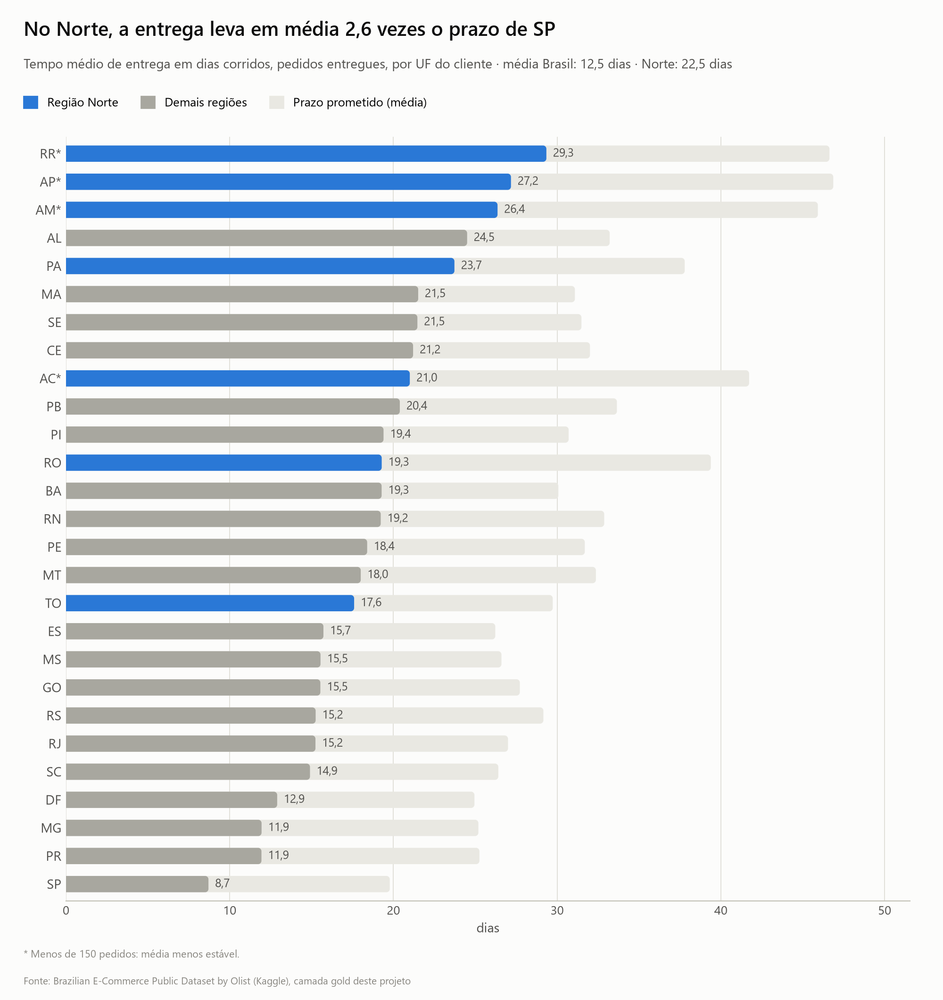
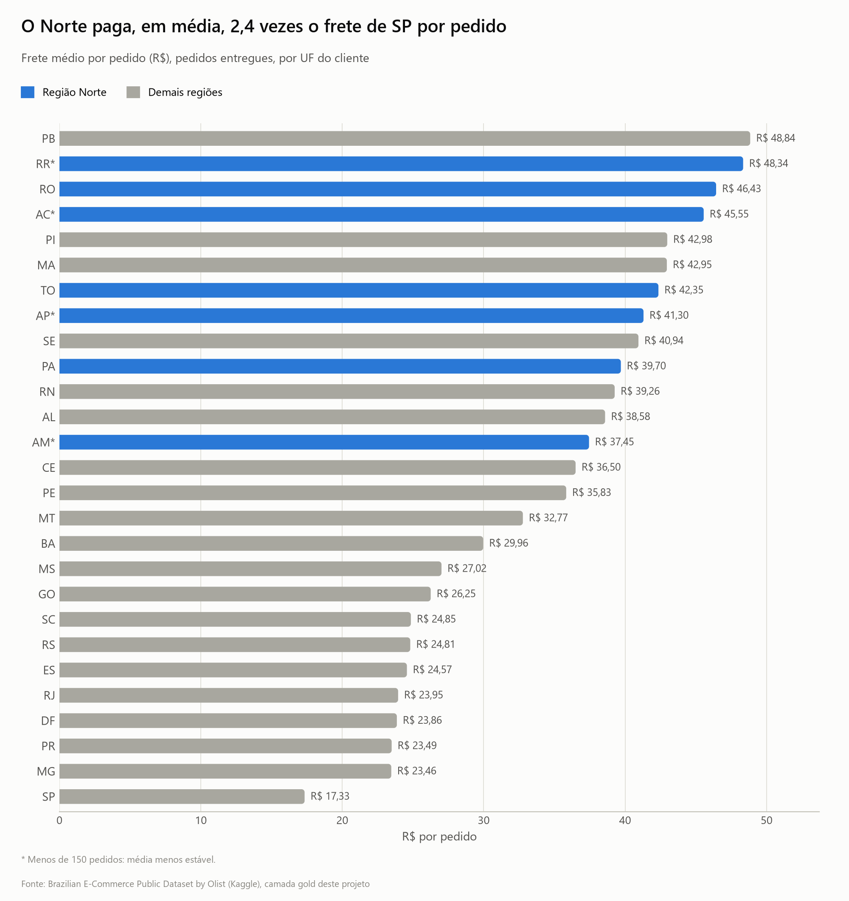
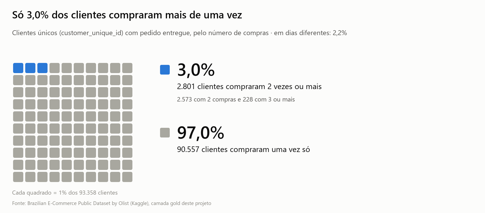

# Relatório de análises

> Gerado automaticamente pelo notebook [`notebooks/analysis.ipynb`](../notebooks/analysis.ipynb) a partir da camada gold. As premissas estão na seção 6 do [README](../README.md).

## 1. Vendas: Como a receita total varia mês a mês?

A receita cresceu rápido: 2017 fechou em R$ 5,96 mi e, de janeiro a agosto de 2018, já foram R$ 7,22 mi, **141% a mais** que no mesmo período de 2017. O pico foi em nov/2017, puxado pela Black Friday, e em 2018 as vendas se estabilizaram. Novembro merece um planejamento próprio de estoque e entrega, e o próximo salto de crescimento deve vir de outras frentes, como a recompra e novas regiões.

## 2. Logística: Qual o tempo médio de entrega, em dias, por estado?

Um pedido leva em média **12,5 dias** para chegar, mas o tempo varia muito: 8,7 dias em SP e 22,5 no Norte. Lá, mesmo com um prazo prometido folgado (em média, 15,6 dias a mais que a entrega real), 8,6% dos pedidos atrasam, acima dos 6,8% do país; no Nordeste, são 12,7%. O desafio é encurtar a entrega no Norte e cumprir a promessa no Nordeste. Os números de RR, AP, AM e AC pedem cautela, porque cada um tem menos de 150 pedidos.

## 3. Satisfação: Pedidos atrasados têm nota média menor que os entregues no prazo?

Sim, e a diferença é grande: a nota média é **4,29** para quem recebe no prazo e **2,27** para quem recebe atrasado. Entre os atrasados, 54% dão nota 1, contra 7% dos entregues no prazo, e bastam 1 a 3 dias de atraso para a média cair para 3,29. Cumprir o prazo prometido é o caminho mais direto para a satisfação, com a ressalva de que os dados mostram uma associação, não uma prova de causa.

## 4. Financeiro: Qual o valor médio do frete por estado do cliente?

O frete médio por pedido vai de **R$ 17,33** (SP) a **R$ 48,84** (PB). No Norte, a média é R$ 41,35, o equivalente a 23% do valor dos produtos, contra 14% em SP. Quem paga o frete mais caro é justamente quem espera mais pela entrega, e é nessas regiões que ter estoque perto do cliente faria mais diferença.

## 5. Clientes: Qual a porcentagem de clientes que compraram mais de uma vez?

Quase ninguém volta: só **3,0%** dos 93.358 clientes compraram mais de uma vez, ou 2,2% contando apenas compras em dias diferentes. Há muito espaço para retenção, com CRM e cupom de segunda compra, e o primeiro passo é entregar no prazo, já que o atraso derruba a satisfação. Um cuidado na medição: pelo `customer_id`, que muda a cada pedido, a recompra daria 0%.

