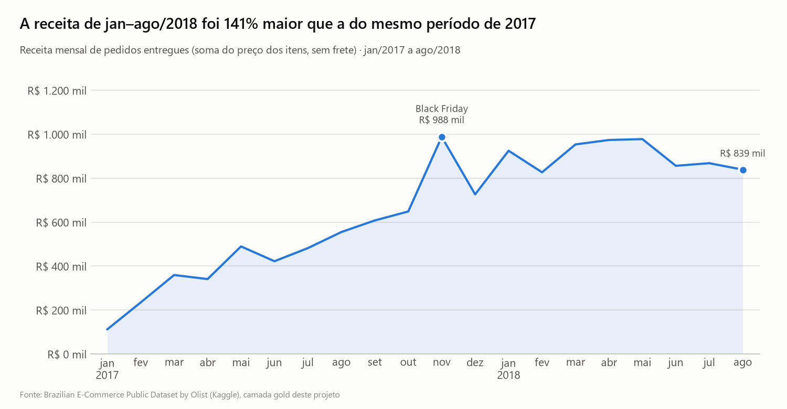

# Relatório de análises

> Gerado automaticamente pelo notebook [`notebooks/analysis.ipynb`](../notebooks/analysis.ipynb) a partir da camada gold. As premissas estão na seção 6 do [README](../README.md).

## 1. Vendas: Como a receita total varia mês a mês?

A receita mais que dobrou: **+141%** em jan–ago/2018 frente ao mesmo período de 2017 (de R$ 2,99 mi para R$ 7,22 mi). O pico foi em **nov/2017**, mês da Black Friday (R$ 988 mil), e em 2018 a receita ficou num patamar de R$ 826 a 978 mil por mês. **Para o negócio:** novembro exige planejar estoque e logística com antecedência, e o platô de 2018 indica que o próximo salto depende de novas alavancas, como recompra e expansão regional.

## 2. Logística: Qual o tempo médio de entrega, em dias, por estado?

O prazo médio no Brasil é de **12,5 dias**, mas depende muito da distância: no Norte vai de 17,6 a 29,3 dias, contra 8,7 em SP. Mesmo assim, o Norte atrasa pouco (AM: 2,8% dos pedidos), porque o prazo prometido já embute a distância; os maiores índices de atraso estão em AL (Nordeste, 21,4%) e MA (Nordeste, 17,4%). **Para o negócio:** no Norte, o desafio é encurtar o prazo, não só cumprir a promessa. _Ressalva: RR, AP, AM e AC têm menos de 150 pedidos cada; as médias desses estados oscilam mais._

## 3. Satisfação: Pedidos atrasados têm nota média menor que os entregues no prazo?

Sim, e a diferença é grande: a nota média cai de **4,29** (no prazo) para **2,27** (atrasados), e 54% dos pedidos atrasados recebem nota 1, contra 7% dos entregues no prazo. A queda começa logo: só 1 a 3 dias de atraso já levam a média a 3,29. **Para o negócio:** cumprir o prazo prometido é a alavanca mais direta de satisfação, e prometer um prazo realista ajuda tanto quanto entregar rápido. _Associação observada, não prova de causa._

## 4. Financeiro: Qual o valor médio do frete por estado do cliente?

O frete médio por pedido vai de **R$ 17,33** em SP a **R$ 48,84** em PB; no Norte, chega a R$ 48,34 (RR) e equivale a 28% do valor dos produtos, contra 14% em SP. As regiões que mais esperam pela entrega (pergunta 2) são as que mais pagam frete. **Para o negócio:** prazo e frete são as duas barreiras de compra no Norte e no Nordeste, onde uma operação com estoque perto do cliente tem vantagem.

## 5. Clientes: Qual a porcentagem de clientes que compraram mais de uma vez?

Apenas **3,0%** dos 93.358 clientes compraram mais de uma vez (2.801 clientes); contando só compras em dias diferentes, a recompra cai para 2,2%. A base é quase toda de compradores únicos: há espaço claro para retenção (CRM, cupom de segunda compra), começando pela experiência de entrega, que pesa na satisfação (pergunta 3). _Com `customer_id` no lugar de `customer_unique_id`, a recompra daria 0%, porque esse identificador muda a cada pedido._

