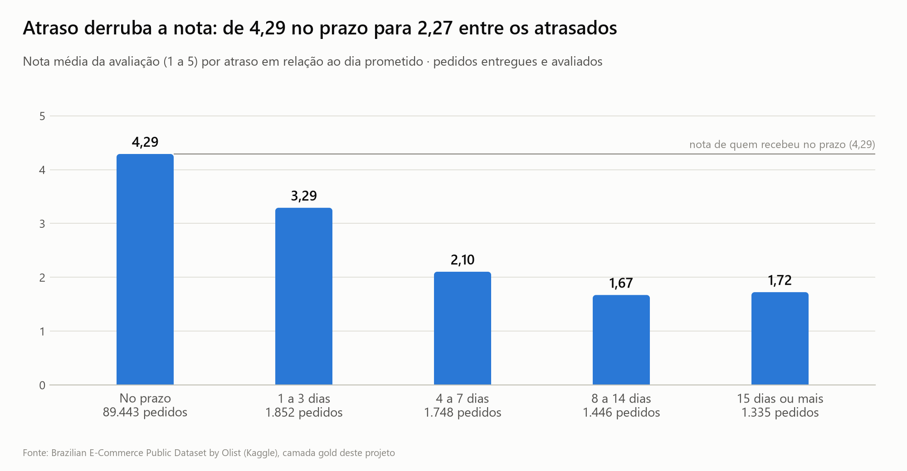

# Relatório de análises

> Gerado automaticamente pelo notebook [`notebooks/analysis.ipynb`](../notebooks/analysis.ipynb) a partir da camada gold. As premissas estão na seção 6 do [README](../README.md).

## 1. Vendas: Como a receita total varia mês a mês?

A receita de jan–ago/2018 foi **141% maior** que a de jan–ago/2017 (R$ 2,99 mi → R$ 7,22 mi), com pico em **nov/2017** (Black Friday) e um platô ao longo de 2018. **Para o negócio:** planejar estoque e logística para novembro e buscar novas alavancas de crescimento, como recompra e expansão regional.

## 2. Logística: Qual o tempo médio de entrega, em dias, por estado?

O prazo médio é de **12,5 dias**, mas vai de 17,6 a 29,3 dias no Norte, contra 8,7 em SP. Mesmo com 15,6 dias de folga média no prazo prometido, o Norte atrasa **8,6%** dos pedidos (Brasil: 6,8%); o Nordeste é o que mais atrasa (12,7%). **Para o negócio:** encurtar o prazo no Norte e cumprir a promessa no Nordeste. _RR, AP, AM e AC têm menos de 150 pedidos cada._

## 3. Satisfação: Pedidos atrasados têm nota média menor que os entregues no prazo?

Sim: nota média **4,29** no prazo contra **2,27** nos atrasados, e 54% dos atrasados dão nota 1 (no prazo: 7%). Só 1 a 3 dias de atraso já derrubam a média para 3,29. **Para o negócio:** cumprir o prazo prometido é a alavanca mais direta de satisfação. _Associação observada, não prova de causa._

## 4. Financeiro: Qual o valor médio do frete por estado do cliente?

O frete médio por pedido vai de **R$ 17,33** em SP a **R$ 48,84** em PB; no Norte chega a R$ 48,34 (RR), 28% do valor dos produtos (SP: 14%). **Para o negócio:** frete caro e prazo longo atingem as mesmas regiões, onde ter estoque perto do cliente vira vantagem competitiva.

## 5. Clientes: Qual a porcentagem de clientes que compraram mais de uma vez?

Só **3,0%** dos 93.358 clientes compraram mais de uma vez (2,2% em dias diferentes). **Para o negócio:** a base é quase toda de compradores únicos; há espaço para retenção (CRM, cupom de segunda compra), começando pela entrega, que pesa na satisfação. _Com `customer_id`, que muda a cada pedido, a recompra daria 0%._

